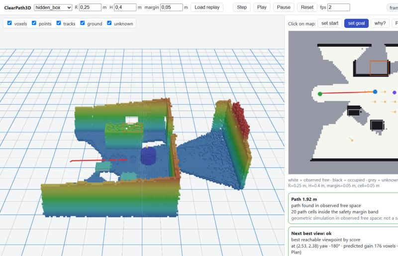

# ClearPath3D — Spatial Scene Inspector & Active Perception

> **Status:** M0–M3, M5, optional ICP and semantics done; interactive simulated-drive demo; a real-data
> check on a TUM RGB-D robot sequence; held-out synthetic benchmark
> (20 unseen rooms: 0 false-free cells, 15/15 passable doors, NBV better than random in 19/20);
> M4 API + viewer done, **ROS 2 adapter written but not yet run in ROS**.
> Every number in this repository comes from a saved report — see `PROGRESS.md`,
> `docs/experiments.md` and `docs/limitations.md`.

ClearPath3D turns an RGB-D sequence into an inspectable scene and answers, for a small *simulated* robot:
**can it pass here, what blocks it, and where should it look to learn more?**



## What it does

- **Explicit frames** (`docs/coordinates.md`): `T_A_B` maps B → A; optical x right / y down / z forward;
  `map` and `base_link` z up. Tested with property tests and an asymmetric ray-cast scene.
- **Reproducible synthetic RGB-D** (Open3D `RaycastingScene`, real occlusions, parametric noise/dropout) with a
  strict split: `sensor_export/` (pipeline input) vs `ground_truth/` (evaluator only, guarded by tests).
- **Single frame**: gated ground detection (the largest plane is *not* assumed to be the floor; no floor →
  explicit `unavailable`), DBSCAN obstacles with visible-extent boxes.
- **Multi-view**: TSDF fusion with **supplied** poses (and a point-union baseline); Redwood sample adapter whose
  conventions were measured, not assumed.
- **Visibility map**: log-odds voxels updated along depth rays (holes free nothing, nothing behind a hit),
  2D map with explicit **unknown**, change events, Kalman/Hungarian tracking.
- **Planning**: footprint-aware A* that never crosses unknown space and explains failures
  (`blocked_by_obstacles` vs `blocked_by_unknown`, `goal_footprint_blocked`, ...).
- **Active perception**: next-best-view from the observed map only, compared to random viewpoints.
- **Inspector**: local API + web viewer with a "why?" mode citing the frames behind each cell.
- **Pose estimation (optional)**: gated ICP odometry that rejects doubtful frames instead of drifting.
- **Real data**: TUM RGB-D robot sequence (`clearpath3d download-tum`, `clearpath3d real-benchmark`): ground
  found on 83/83 real frames (2 cm median height error); planning on the real map; depth-only ICP shown to
  fail on this sequence and to refuse rather than drift (see `docs/experiments.md`, E9).
- **Semantics (optional)**: Mask R-CNN detections lifted to 3D with their masks and voted onto tracks
  (`pip install -r requirements-semantics.txt`, `clearpath3d m6-semantics`).

Not implemented: loop closure, real sensors. The robot is simulated; paths are geometric.

## Quick start (Windows, Python 3.12)

```bash
py -3.12 -m venv .venv
.venv/Scripts/python -m pip install -r requirements.lock
.venv/Scripts/python -m pip install --no-deps -e .
.venv/Scripts/python -m pytest
```

Open3D is pinned to **0.19.0**: the 0.20.0 Windows wheel integrates no TSDF surface (see `PROGRESS.md`, M2).

### Reproduce the reference results

```bash
.venv/Scripts/clearpath3d m1-demo          # single-frame ground/obstacles
.venv/Scripts/clearpath3d download-redwood # explicit 11 MB download (optional, for M2 real-data checks)
.venv/Scripts/clearpath3d m2-demo          # TSDF vs point union
.venv/Scripts/clearpath3d m3-demo          # map, unknown space, A*, moving box
.venv/Scripts/clearpath3d m5-experiment    # next-best-view vs random (~10 min)
.venv/Scripts/clearpath3d m6-odometry      # ICP odometry ablation (~25 min)
.venv/Scripts/clearpath3d m6-semantics     # semantic lifting (oracle + Mask R-CNN on Redwood)
.venv/Scripts/clearpath3d benchmark dev    # procedural rooms; validation / test (frozen splits)
```

### Viewer

```bash
.venv/Scripts/python -m uvicorn clearpath3d_api.main:app --app-dir apps/api --port 8010
```

```bash
cd apps/viewer && npm install && npm run dev
```

Open http://localhost:5173, pick a scene, **Load replay**, **Play**. Click the map to set a goal, **Plan**,
switch to **why?** and click a cell, or press **Next best view**. On synthetic scenes the demo panel can
**move an object in the simulator** and **drive** the simulated robot to the goal: it looks before moving,
re-plans on every new view, and the timeline shows the map at any step with a before/after diff.
R / H / margin sliders re-plan live.

### ROS 2 (WSL2 Ubuntu 24.04, Jazzy) — not yet verified

```bash
bash ros2_ws/scripts/install_ros2_jazzy_wsl.sh   # inside WSL, needs sudo
bash ros2_ws/scripts/verify_ros.sh               # builds, launches, checks topics/tf/QoS, records a bag
```

## Layout

```text
src/clearpath3d/   contracts, geometry/, datasets/, perception/, reconstruction/, mapping/, planning/,
                   runtime/ (pipeline, replay, session), evaluation/ (GT side only), cli.py
apps/api/          FastAPI layer          apps/viewer/   React + Three.js viewer
ros2_ws/           ROS 2 package, install/verify scripts
configs/  tests/  docs/  artifacts/demo/
```

## License

MIT.
